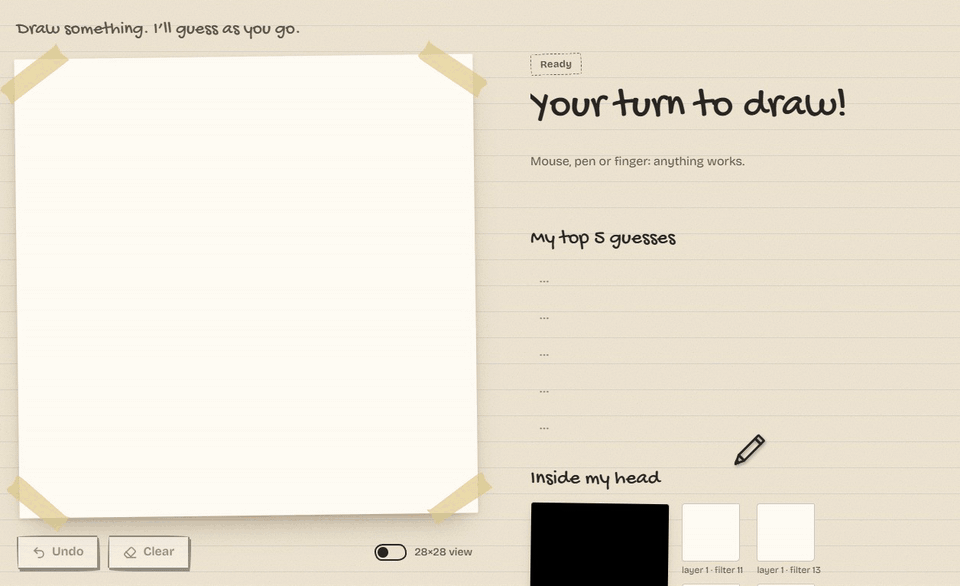
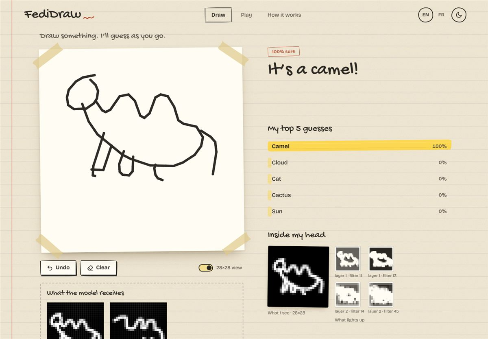
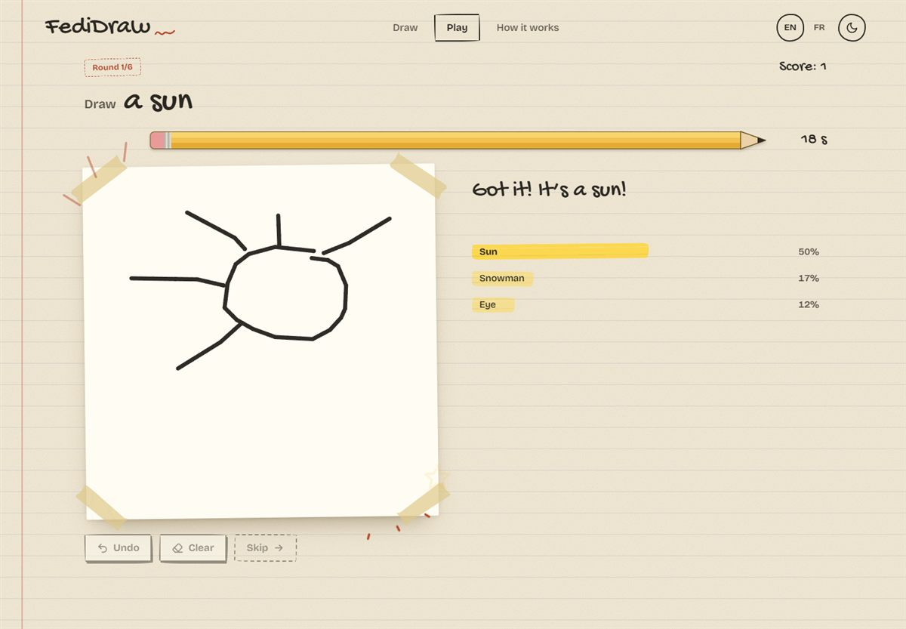
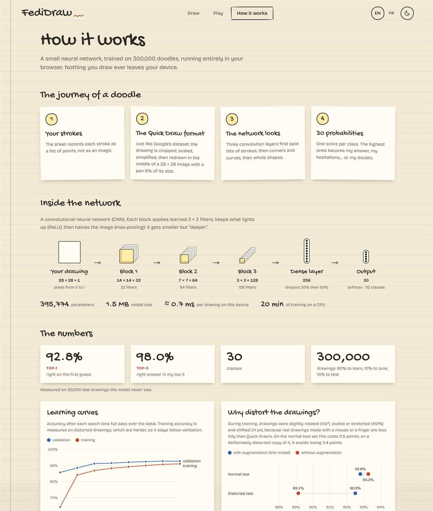
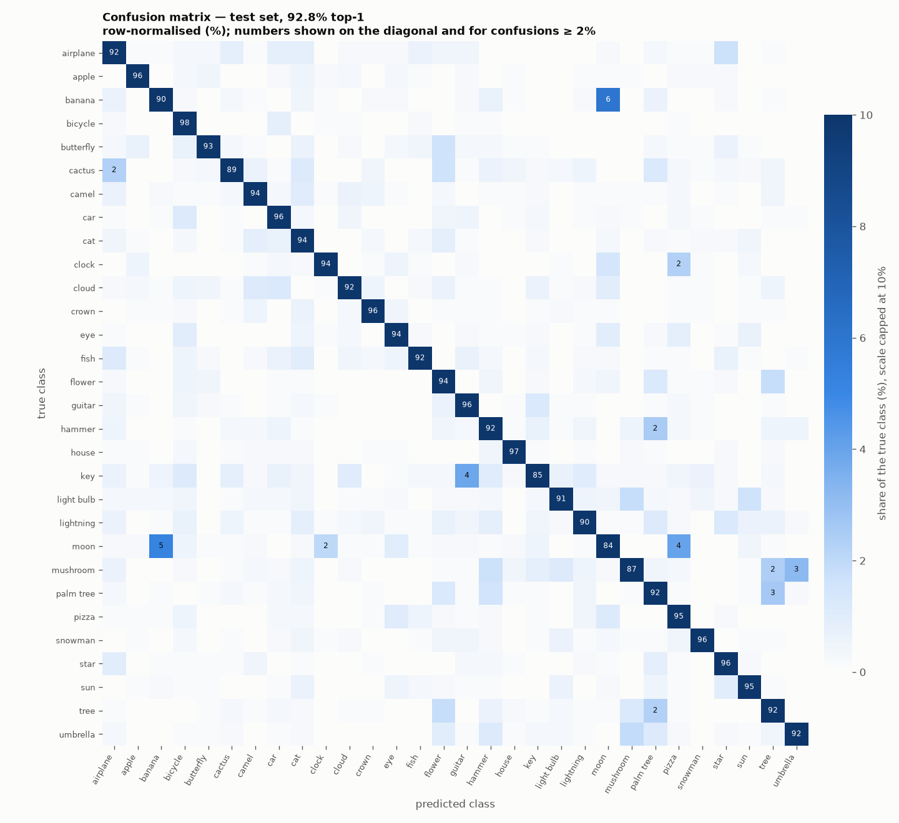

# FediDraw

**AI that reads your doodles in real time.**

Draw on the sheet and FediDraw guesses what it is while you draw: an answer in its own handwriting, its top-5 guesses and a live peek inside the neural network. Everything runs locally in your browser. No server, no account, and nothing you draw ever leaves your device.



| 92.8 % | 98 % | 30 | 1.5 MB | ~1 ms | 100 % |
|:---:|:---:|:---:|:---:|:---:|:---:|
| top-1 accuracy | top-5 accuracy | classes | model size | per drawing | offline |

---

## Run it locally

You need [Node.js](https://nodejs.org) 20.19 or newer (tested with Node 24). The trained model is included, so Python is only needed to retrain it.

### Windows: double-click

Double-click **`start.bat`** at the root of the project. On first launch it installs the dependencies, then it builds the app and opens it in your browser at <http://localhost:4173>. Close the window to stop it.

To use FediDraw from a phone or tablet on the same Wi-Fi, run `start.bat lan` from a terminal and open the *Network* address it prints (allow access if the Windows firewall asks).

### Any platform: npm

```powershell
cd web
npm install
npm run dev          # development server with hot reload: http://localhost:5173
```

Optimised version:

```powershell
npm run build        # type-check and build into web/dist
npm run preview      # serve the build: http://localhost:4173
```

Add `:lan` to open it from a phone on the same network: `npm run dev:lan` or `npm run preview:lan`.

---

## Features

- **Free drawing** with mouse, pen or finger. FediDraw answers as you draw, in three moods: *still looking*, *torn between two* (with a tip to tell them apart, e.g. "add craters to the moon, or a little stem to the banana!") or *sure at 91 %*. Undo, clear, and a live top-5 drawn as highlighter strokes.
- **Inside my head**: the exact 28 × 28 image the model receives and a few activation maps of the network lighting up in real time. A debug view shows the model input pixel by pixel next to a real Quick Draw drawing.
- **The pencil challenge**: six random words, twenty seconds each, with a timer shaped like a pencil that wears down. Celebration scribbles when the AI finds your drawing, a page turn between rounds, and your six drawings with your times at the end. Your best score is remembered.
- **How it works**: the drawing pipeline, the network architecture, learning curves, per-class accuracy and an interactive confusion matrix, all built from the real evaluation results.
- **English and French**, paper and blackboard themes, works on phones down to 320 px wide, respects *reduced motion*.

| Drawing | Pencil challenge | How it works |
|---|---|---|
|  |  |  |

---

## How it works

### From strokes to a guess

1. **Strokes, not pixels.** The canvas records every stroke as a list of points.
2. **The Quick Draw format.** The model was trained on Google's [Quick, Draw!](https://github.com/googlecreativelab/quickdraw-dataset) bitmaps, and those are rendered from vector strokes, not cropped from photos. Before writing any preprocessing, we measured their exact format by re-rendering Google's vector drawings until they matched the official bitmaps (see [training/reports/format_report.md](training/reports/format_report.md)): white strokes on black, drawing centred, longest side scaled to 255 units, a 16-unit round pen, 16 units of padding, then 28 × 28 with anti-aliasing. FediDraw replays that pipeline on your strokes, including resampling and Ramer-Douglas-Peucker simplification. The pen is therefore always about 6 % of the drawing's size, however large you draw and whatever the screen.
3. **The network.** A small convolutional network runs in a Web Worker with [ONNX Runtime Web](https://onnxruntime.ai/) (WebAssembly), so drawing and animations never wait for it.
4. **30 probabilities** become the answer, the top 5 and the hesitation tips.

The browser preprocessing is checked against Google's own bitmaps: on 64 real Quick Draw drawings it reproduces the official images within **1.7 grey levels** on average (0–255 scale). This is the `npm test` parity test.

### The network

| Layer | Output | Details |
|---|---|---|
| Input | 28 × 28 × 1 | pixels in 0..1, normalisation built into the model |
| Block 1 | 14 × 14 × 32 | conv 3 × 3, batch norm, ReLU, max-pool |
| Block 2 | 7 × 7 × 64 | conv 3 × 3, batch norm, ReLU, max-pool |
| Block 3 | 3 × 3 × 128 | conv 3 × 3, batch norm, ReLU, max-pool |
| Dense | 256 | dropout 30 % before, 50 % after, ReLU |
| Output | 30 | softmax |

395,774 parameters, 1.5 MB in ONNX. Inference takes about 1 ms per drawing on a desktop CPU. The *How it works* page measures it on your own device.

**Training data:** 10,000 drawings for each of the 30 classes (300,000 in total), split 80 / 10 / 10 into training, validation and test sets. **Training:** 8 epochs with AdamW and a one-cycle learning rate, about 20 minutes on a 6-core desktop CPU (no GPU needed).

**Classes:** airplane, apple, banana, bicycle, butterfly, cactus, camel, car, cat, clock, cloud, crown, eye, fish, flower, guitar, hammer, house, key, light bulb, lightning, moon, mushroom, palm tree, pizza, snowman, star, sun, tree, umbrella.

---

## Results

Measured on 30,000 test drawings the model never saw: **92.8 % top-1** and **98.0 % top-5** accuracy.

### Data augmentation

Real drawings made with a mouse or a finger are less tidy than Quick Draw's, so the shipped model was trained on slightly distorted drawings: rotation ±10°, scale and aspect ratio ±10 %, shift ±1 px. Stroke width is not varied, because the preprocessing keeps it constant. The *distorted* test set applies the same kind of random distortions, once and with a fixed seed, to the test drawings.

| Model | Clean test top-1 | Clean test top-5 | Distorted test top-1 | Distorted test top-5 |
|---|---|---|---|---|
| **With augmentation (shipped)** | 92.80 % | 98.03 % | **92.50 %** | 97.98 % |
| Without augmentation | **93.27 %** | 98.14 % | 89.14 % | 97.31 % |

Augmentation costs 0.5 point on clean drawings, but the model without it loses 4.1 points as soon as drawings are slightly tilted or stretched, against 0.3 point for the augmented one.

**Caveat:** the distorted test uses the same family of transforms as the training augmentation, so it naturally favours the augmented model. It shows robustness to those distortions, not a guaranteed gain on real users' drawings; the real test is your drawings.

### Confusion matrix



Most frequent mix-ups (share of the true class):

| True class | Predicted as | Rate |
|---|---|---|
| banana | moon | 6.0 % |
| moon | banana | 5.2 % |
| moon | pizza | 4.0 % |
| key | guitar | 3.9 % |
| mushroom | umbrella | 3.2 % |
| palm tree | tree | 2.6 % |

The weakest classes are moon (84.3 %), key (85.0 %) and mushroom (86.6 %); the strongest are bicycle, house and crown (above 96 %). Learning curves, per-class accuracy and the augmentation chart are in [training/reports/](training/reports/).

### Lighthouse

Production build (`npm run build` + `npm run preview`), Lighthouse 13 in Microsoft Edge:

| Page | Mode | Performance | Accessibility | Best practices | SEO |
|---|---|---|---|---|---|
| Draw | mobile | 99 | 100 | 100 | 100 |
| Draw | desktop | 100 | 100 | 100 | 100 |
| Pencil challenge | mobile | 100 | 100 | 100 | 100 |
| Pencil challenge | desktop | 100 | 100 | 100 | 100 |
| How it works | mobile | 100 | 100 | 100 | 100 |
| How it works | desktop | 100 | 100 | 100 | 100 |

---

## Tests

```powershell
cd web
npm test             # unit tests: preprocessing parity with Quick Draw, answer states, game logic
npm run build
npm run preview      # keep it running, then in another terminal:
npm run smoke        # 35 checks in a real browser (Edge or Chrome)
```

The smoke test draws real Quick Draw doodles with the mouse and with simulated touch. It checks that ink lands exactly under the pointer, that drawings are recognised, a full game, the *How it works* charts, 320 px screens and reduced motion, and saves screenshots to `web/smoke-output/`.

---

## Retrain the model

Requires Python 3.13. Commands for Windows PowerShell:

```powershell
cd training
python -m venv .venv
.\.venv\Scripts\Activate.ps1
pip install -r requirements.txt

python download.py              # Quick Draw bitmaps, 10,000 per class -> data/quickdraw_30.npz (~3 GB downloaded, 225 MB kept)
python visualize.py             # reports/samples.png
python inspect_format.py        # measures the bitmap format -> reports/format_report.md
python train.py                 # with augmentation, ~20 min on CPU -> checkpoints/aug.pt
python train.py --no-augment    # optional: the baseline for the comparison
python evaluate.py              # confusion matrix, per-class accuracy, metrics.json
python export_onnx.py           # ONNX export + labels.json + metrics.json, copied to web/public/
python make_parity_fixture.py   # optional: refresh the preprocessing test data
```

- **Resumable download.** `download.py` resumes interrupted downloads and checks every file against the MD5 published by Google Cloud Storage, so you can simply run it again.
- **GPU.** `train.py` uses CUDA automatically when available; install the CUDA build of PyTorch from [pytorch.org](https://pytorch.org/get-started/locally/).
- **CPU threads.** On hybrid Intel CPUs, `--threads` defaults to 6 because using only the performance cores is faster.
- **Checked export.** `export_onnx.py` verifies that ONNX Runtime matches PyTorch on the whole test set before writing anything.

The class list lives in [training/config.py](training/config.py). The web app reads the classes, the preprocessing parameters and the metrics from the exported files, so a retrained model needs no code change.

---

## Project structure

```
training/            Python + PyTorch: download, format inspection, training, evaluation, ONNX export
  reports/           figures and metrics produced by the scripts
web/                 Vite + TypeScript app (no framework)
  public/model/      fedidraw.onnx, labels.json, metrics.json, samples.json
  src/preprocess.ts  strokes -> 28 x 28 input, Quick Draw pipeline
  src/pages/         draw, play (pencil challenge), how it works
  scripts/smoke.mjs  end-to-end browser test
start.bat            one-click local launch on Windows
```

---

## Limits

- **It only knows 30 things.** Draw a dragon and it will still pick one of its 30 classes; there is no "I don't know" class.
- **Some shapes look alike**: a crescent moon and a banana, a key and a guitar, a mushroom and an umbrella. Hesitation tips help, but these remain the main sources of error.
- **28 × 28 pixels** is all the network sees, so small details disappear.
- **It learned from Quick Draw doodles**, drawn in under 20 seconds by people around the world in 2016–2017. Very different styles, or detailed drawings, can surprise it.
- **Only the shape counts**: colour, fill, stroke order and drawing speed are ignored.
- **Fixed model**: it does not learn from your drawings, and nothing is stored or sent.
- **Accessibility**: Lighthouse scores 100, but drawing itself requires a mouse, pen or finger. Everything else works with the keyboard.

---

## Credits

- **Data:** [Quick, Draw! dataset](https://github.com/googlecreativelab/quickdraw-dataset) by Google, licensed under [CC BY 4.0](https://creativecommons.org/licenses/by/4.0/).
- **Inference:** [ONNX Runtime Web](https://onnxruntime.ai/) (MIT). **Training:** [PyTorch](https://pytorch.org/).
- **Fonts:** [Gochi Hand](https://fonts.google.com/specimen/Gochi+Hand) and [Bricolage Grotesque](https://fonts.google.com/specimen/Bricolage+Grotesque), SIL Open Font License, self-hosted via Fontsource.

## License

[MIT](LICENSE). The Quick Draw data and the fonts keep their own licenses (above).
